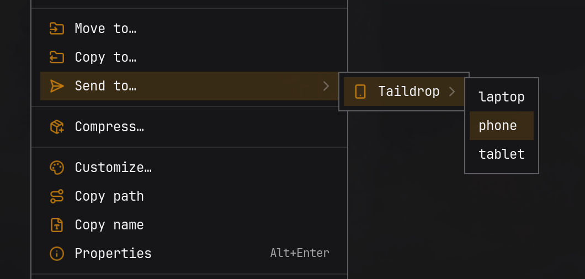
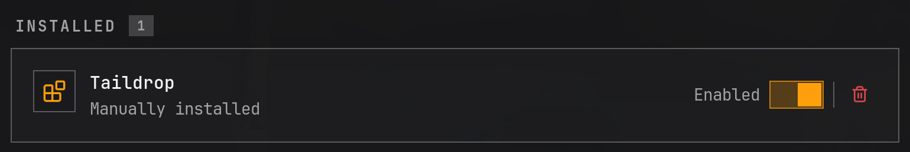
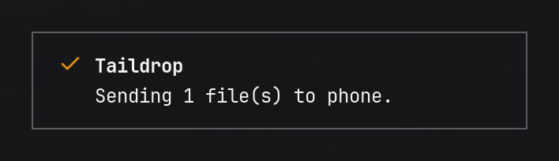

# Strata Taildrop

[](https://github.com/joaodrp/strata-taildrop/actions/workflows/ci.yml)
[](LICENSE)

Send files to your phone, tablet or laptop over [Tailscale](https://tailscale.com/), straight
from the right-click menu of the [Strata](https://stratafiles.io/) file manager. Pick
**Send to -> Taildrop**, pick a device, done.



## Highlights

- 📤 Your devices sit under **Send to**, next to drives and LocalSend. No app to switch to, no
  share sheet, no picker window.
- 📱 Only devices that can take a file right now: online, yours, and with Taildrop on. Nothing
  to configure; it follows your tailnet.
- 🚀 Big files never freeze the menu. The transfer runs in the background and a notification
  says when it landed, or why it did not.
- 🔒 Sends the files you picked, not whatever sits at their path later. If one is edited, replaced
  or swapped between opening the menu and choosing a device, the send is refused.
- 🧩 One Python file, standard library only. No daemon, no settings, no accounts beyond the
  Tailscale you already run.

## Install

```sh
curl -fsSL https://raw.githubusercontent.com/joaodrp/strata-taildrop/main/install.sh | bash
```

Then in Strata open **Settings -> Integrations** and select **Refresh**. Taildrop shows up as
manually installed, with a switch to turn it off.



Prefer to read before you run? The [installer](install.sh) is short: it copies
`provider.py` into `~/.config/strata/providers/taildrop/` and writes the `provider.json` Strata
reads. From a clone, `./install.sh` installs that checkout.

## Sending

Right-click one or more files, then **Send to -> Taildrop -> device**. Strata confirms the send
started:



and a desktop notification follows once the device has the files:


If the transfer fails, the notification says why, in Tailscale's own words. Where the files
land depends on the device; see
[receiving with Taildrop](https://tailscale.com/kb/1106/taildrop) for each platform.

**Files only.** Taildrop cannot send folders, so Taildrop is not offered when the selection
includes one. Use **Compress...** first and send the archive.

## Requirements

- [Strata](https://stratafiles.io/) 1.1.1 or newer
- [Tailscale](https://tailscale.com/download/linux) with
  [Taildrop](https://tailscale.com/kb/1106/taildrop) on for your tailnet
- Your user allowed to send without `sudo`. On most Linux installs `tailscaled` runs as root, so
  set yourself as operator:

  ```sh
  sudo tailscale set --operator=$USER
  ```

- Python 3.10 or newer, at `/usr/bin/python3` or on `PATH`
- For the result notification: Omarchy's notifier, or `notify-send` (`libnotify`) on other desktops

## Troubleshooting

| You see | Try |
| --- | --- |
| No Taildrop under **Send to** | A folder is selected, or no device can receive right now. Check with `tailscale file cp --targets` |
| Taildrop missing from Integrations | Select **Refresh**, or restart Strata |
| A permission error in the notification | Set the operator as above |
| "This menu expired" | The menu was open for over two minutes, or the device list changed. Open it again |
| "The selected files changed" | A file was edited or replaced after the menu opened. Open it again to send the new version |

## Privacy

- **Nothing leaves your tailnet.** Files go device to device with `tailscale file cp`; this
  provider makes no network connections of its own.
- **Only what you pick, only when you pick it.** It reads files when you choose a device, never
  to draw the menu. No index, no log, and no service to set up: the only process is the one
  Strata starts and stops with the provider.

[How it works](docs/how-it-works.md) has the detail.

## Update

Run the installer again; it updates in place. Select **Refresh** in Strata afterwards.

## Remove

```sh
curl -fsSL https://raw.githubusercontent.com/joaodrp/strata-taildrop/main/install.sh | bash -s -- --uninstall
```

Or select the bin icon next to Taildrop in **Settings -> Integrations**.

## Contributing

Bug reports and pull requests are welcome. See [CONTRIBUTING.md](CONTRIBUTING.md) to get set up, and
[docs/how-it-works.md](docs/how-it-works.md) for how the pieces fit.

## License

MIT, see [LICENSE](LICENSE). Not affiliated with Tailscale or Strata.
